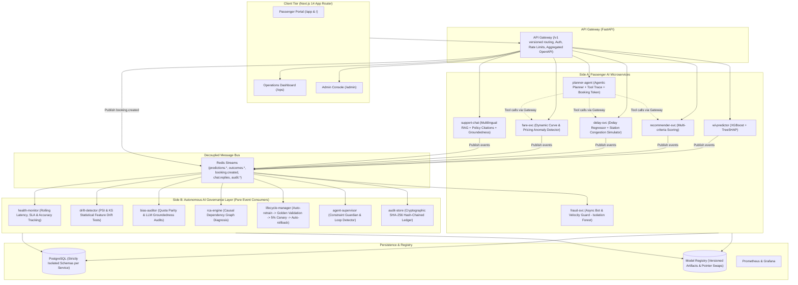

# Indian Railways Intelligent Travel & Autonomous AI Governance Platform

An enterprise-grade, microservice-based dual-sided railway intelligence system comprising 7 passenger-facing AI services and an autonomous AI-for-AI governance layer. Built with zero placeholders, strict container isolation, frozen Pydantic contracts, and single-command orchestration via `docker compose up`.

---

## Architecture Diagram



---

## Core System Topology & Port Mapping

| Service | Container Name | Port | Description |
| :--- | :--- | :--- | :--- |
| **Frontend** | `railway-frontend` | `3000` | Next.js 14 App Router (`/`, `/ops`, `/admin`, `/privacy`, `/terms`) |
| **API Gateway** | `railway-gateway` | `8000` | Unified `/v1` reverse-proxy, rate limiter, and OpenAPI aggregator |
| **WL Predictor** | `railway-wl-predictor` | `8001` | XGBoost + TreeSHAP explainability + berth probability |
| **Recommender** | `railway-recommender` | `8002` | Multi-criteria utility ranking engine with user personalization |
| **Delay Predictor** | `railway-delay-predictor` | `8003` | Delay regression model + station congestion indicator |
| **Fare Predictor** | `railway-fare-predictor` | `8004` | Dynamic pricing curves + anomaly surge detection |
| **Planner Agent** | `railway-planner-agent` | `8005` | Conversational NL agent + tool orchestration + booking tokens |
| **Customer Support**| `railway-support-assistant` | `8006` | Multilingual (EN/HI) RAG with official policy citations |
| **Fraud Detector** | `railway-fraud-detector` | `8007` | 100% async event consumer with velocity rules + Isolation Forest |
| **AI Governance** | `railway-governance` | `8008` | Health, drift (PSI/KS), bias, RCA, canary manager, SHA-256 audit log |
| **Data Generator** | `railway-data-generator` | &mdash; | Deterministic seed generator (`seed=42`) + live event telemetry |
| **Redis** | `railway-redis` | `6379` | Redis Streams event bus backbone |
| **PostgreSQL** | `railway-postgres` | `5432` | Dedicated database instances with strictly separated access |
| **Prometheus** | `railway-prometheus` | `9090` | Time-series metrics scraper |

---

## Quick Start (Under 10 Minutes)

### Prerequisites
- Docker Engine 24+ and Docker Compose v2+
- (Optional for standalone host execution) Python 3.10+

### Step 1: Clone & Configure
```bash
cp .env.example .env
```

### Step 2: Boot Platform
```bash
docker compose up --build
```
On boot, `data-generator` automatically seeds 15,000+ booking records, 12,000+ delay logs, 10,000+ fraud events, trains baseline models (`v1.0.0`), and starts streaming live telemetry.

### Step 3: Access Applications
- **Passenger Portal:** [http://localhost:3000](http://localhost:3000)
- **Operations Dashboard:** [http://localhost:3000/ops](http://localhost:3000/ops)
- **Admin Console:** [http://localhost:3000/admin](http://localhost:3000/admin)
- **API Gateway Swagger Docs:** [http://localhost:8000/docs](http://localhost:8000/docs)
- **Prometheus Metrics:** [http://localhost:9090](http://localhost:9090)

---

## Running the Automated Test Suite & Master Demo

### Execute Unified Test Suite
```bash
python run_tests.py
```
Validates frozen contracts, isolated microservices, and the full closed-loop governance cycle.

### Run Master Demo Showcase Script
```bash
python scripts/demo.py
```
This script runs an automated end-to-end demonstration:
1. Queries WL Predictor and displays TreeSHAP feature attributions.
2. Queries the Recommender Engine with multi-criteria scoring.
3. Tests Train Delay & Station Congestion under adverse weather signals.
4. Generates dynamic fare curves with the optimal booking window.
5. Runs the Multilingual Support Assistant over official railway fare rules.
6. Evaluates an async bot attack transaction via Isolation Forest.
7. Injects synthetic covariate drift (`PSI > 0.25`).
8. Observes autonomous RCA root-cause diagnosis.
9. Initiates model retraining, offline validation, and 5% canary deployment.
10. Validates canary performance and executes instant auto-rollback.
11. Mathematically verifies the cryptographic SHA-256 audit ledger.

---

## Model-Swap Guide (Zero-Code-Change Model Swapping)

In accordance with Non-Negotiable Rule 3, models are versioned artifacts registered in the central Model Registry. Services consume models via pointer lookup. **No service code changes during a model promotion, canary test, or rollback.**

### How to Swap or Update a Model:
1. **Train & Save the Candidate Artifact:**
   Export your trained scikit-learn / XGBoost artifact to:
   `models_registry/<model_name>/<new_version>/model.joblib`
2. **Register the Version:**
   ```python
   from shared.model_registry import ModelRegistry
   registry = ModelRegistry("/app/models_registry")
   registry.register_version(
       model_name="wl_predictor",
       version="v1.2.0",
       artifact_path="/app/models_registry/wl_predictor/v1.2.0/model.joblib",
       metrics={"accuracy": 0.945, "p95_latency_ms": 25.0}
   )
   ```
3. **Deploy Canary (5% Traffic Split):**
   ```python
   registry.set_canary("wl_predictor", canary_version="v1.2.0", canary_percentage=5.0)
   ```
4. **Promote to Full Active (Pointer Swap):**
   ```python
   registry.promote_canary("wl_predictor")
   ```
   *The service immediately begins serving `v1.2.0` on the next inference request without restarting the container.*
5. **Instant Rollback:**
   ```python
   registry.rollback("wl_predictor", target_version="v1.0.0")
   ```

---

## Reserved Extension Points

The architecture defines clean extension points. New capabilities arrive strictly as new services behind the API Gateway and new event topics on Redis Streams—**never by editing existing service code**.

### Extension Point 1: Tatkal Automation & Seat Probability (`tatkal-svc`)
- **Container:** `services/tatkal-automation/`
- **Gateway Route:** `/v1/tatkal/*`
- **Event Topics:** Publishes `predictions.tatkal`, consumes `booking.created`.
- **Purpose:** High-concurrency seat availability prediction in the 10:00 AM (AC) and 11:00 AM (Non-AC) Tatkal windows.

### Extension Point 2: IRCTC e-Catering & Station Pantry Integration (`catering-svc`)
- **Container:** `services/catering/`
- **Gateway Route:** `/v1/catering/*`
- **Event Topics:** Consumes `train.telemetry` to adjust pantry delivery station if train delay exceeds 45 minutes.
- **Purpose:** Dynamic meal scheduling matched to real-time train running status.

### Extension Point 3: Crew & Rake Turnaround Scheduler (`crew-rake-svc`)
- **Container:** `services/crew-rake/`
- **Gateway Route:** `/v1/ops/crew/*`
- **Event Topics:** Consumes `predictions.delay` and `train.telemetry`.
- **Purpose:** Dynamic loco pilot duty rostering and rake turnaround optimization at terminus junctions.

---

## UI Guardrails & Frontend Compliance

The frontend in `frontend/` has been constructed to the exact design specifications provided in the mockup images:
- **Left Sidebar:** Dark Navy theme (`#0a192f`) with passenger services and autonomous governance tabs.
- **Retro Pixel Train Banner:** Interactive canvas runner with cloud, cactus, bridge, and spacebar interaction.
- **Utility-First Industrial Design:** Crisp rounded borders, solid green/blue action buttons, no purple gradients, no pill-shaped buttons.
- **Custom Brand Identity:** Metadata domain `railway.internal`, custom SVG locomotive favicon, dedicated Privacy Policy (`/privacy`), and Terms & Conditions (`/terms`).
- **Zero AI Slop:** No fake customer counters, no cursor animations, no emoji icons (clean Lucide icons only), and zero AI attribution watermarks.
